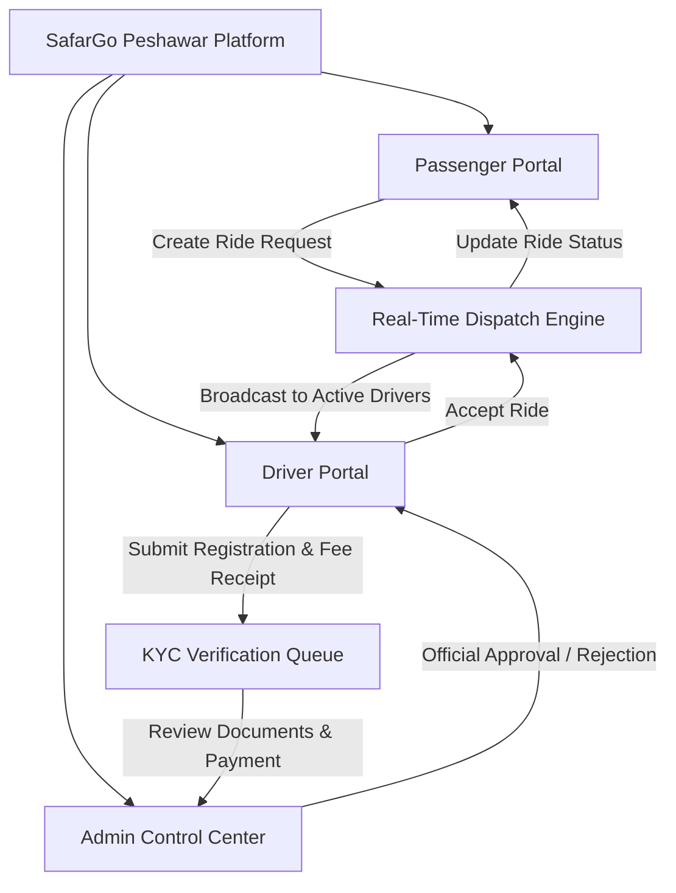

# 🚖 SafarGo Peshawar (سفر گو پشاور) — Complete Features Specification

> **Official Project Features & Technical Capabilities Document**  
> **Platform:** Web, Mobile Responsive & Progressive Web App (PWA)  
> **Target Region:** Peshawar, Khyber Pakhtunkhwa, Pakistan  
> **Primary Technology Stack:** React 19, TypeScript, Tailwind CSS, Leaflet Maps, OSRM Routing, Supabase, Framer Motion

---

## 📑 Table of Contents
1. [Executive Summary & System Architecture](#1-executive-summary--system-architecture)
2. [Interactive Peshawar Map & Road Navigation Engine](#2-interactive-peshawar-map--road-navigation-engine)
3. [Real-Time Ride Matching & Booking Engine](#3-real-time-ride-matching--booking-engine)
4. [Driver Onboarding, KYC & Admin Approval Lock](#4-driver-onboarding-kyc--admin-approval-lock)
5. [Driver Portal (Driver Panel)](#5-driver-portal-driver-panel)
6. [Passenger Experience & Booking Flow](#6-passenger-experience--booking-flow)
7. [Passenger-Driver In-App Communication](#7-passenger-driver-in-app-communication)
8. [Wallet, Payments & Fare Calculations](#8-wallet-payments--fare-calculations)
9. [Safety, SOS & Emergency Hub](#9-safety-sos--emergency-hub)
10. [Admin Control & Management Portal](#10-admin-control--management-portal)
11. [Account Management & User Settings](#11-account-management--user-settings)
12. [PWA, Performance & Offline Resilience](#12-pwa-performance--offline-resilience)

---

## 1. Executive Summary & System Architecture

SafarGo Peshawar is a production-grade, hyper-localized ride-hailing and logistics web application designed specifically for the city of Peshawar. It incorporates three distinct user roles:

- **Passenger Portal:** Real-time road route mapping, instant landmark search, live driver tracking, in-app messaging, wallet, and SOS safety tools.
- **Driver Portal:** Real-time incoming ride alerts, 30-second decision timer, turn-by-turn navigation, speed & distance telemetry, daily earnings, and rating tracker.
- **Admin Portal:** Centralized control room for KYC approvals, payment screenshot verification, real-time fleet monitoring, user management, and revenue metrics.

---

## 2. Interactive Peshawar Map & Road Navigation Engine
**Core Component:** [`src/components/PeshawarRealMap.tsx`](file:///d:/projects/app/peshawar%20app/src/components/PeshawarRealMap.tsx)

### 🛣️ True Road-Following Navigation (OSRM Engine)
- **Real Road Routes:** Instead of straight lines cutting through buildings, routes strictly follow the physical road network of Peshawar (GT Road, University Road, Ring Road, Jamrud Road, Khyber Road, Saddar, etc.) using the Open Source Routing Machine (OSRM) driving API.
- **Google Maps Visual Style:** Dual-polyline rendering featuring a dark green high-contrast casing (`#064e3b`, 8px width) and an inner vibrant emerald green line (`#16a34a`, 5px width).
- **Smooth Local Fallback:** Built-in waypoint fallback algorithm ensuring route rendering even when external routing APIs face temporary network constraints.

### 🎯 Smart Camera Auto-Framing
- Automatically computes bounding boxes (`L.latLngBounds`) across all road coordinates.
- Applies custom viewport padding (`paddingTopLeft: [70, 70], paddingBottomRight: [70, 220]`) to ensure both Pickup and Destination pins remain 100% visible without being obscured by bottom sheets.

### 🔒 Zoom Retention & Zero-Jitter Blue Dot
- **Independent GPS Watcher:** Real GPS tracking (`navigator.geolocation.watchPosition`) updates only the Blue Dot marker coordinates in an isolated effect, eliminating unwanted automatic map zoom-outs while the user inspects the map.
- **Soft Radar Pulse:** Elegant CSS pulse effect without vibrating or jittering.

### 🗺️ 4-in-1 Map Layer Switcher
- **CARTO Voyager:** Ultra-fast, clean CDN vector tiles optimized for high performance.
- **Google Roads:** Crisp road-network imagery.
- **Satellite Hybrid:** High-resolution aerial satellite photography with street labels.
- **OpenStreetMap (OSM):** Detailed community-driven topological mapping.

### 📍 Peshawar Landmark Hotspots & Custom Pin Dropping
- Built-in pins for iconic Peshawar hubs: Islamia College, KTH Hospital, Mall Road Saddar, Peshawar Museum, Tatara Park Phase 3, BRT Hayatabad Terminal, and Karkhano Market.
- **Pin-on-Map Feature:** Tap or drag anywhere on the Peshawar map to drop a pin, complete with reverse geocoding to the nearest recognized sector/landmark.

### 🚗 Vehicle Telemetry & Animated Bearing Rotation
- As the driver progresses towards the passenger, the vehicle marker dynamically rotates its SVG/Emoji icon according to the exact compass bearing (`calculateBearing`) of the road segment.
- Live telemetry displays real-time speed (km/h), distance remaining (km), and dynamic ETA (minutes).

---

## 3. Real-Time Ride Matching & Booking Engine
**Core Components:** [`src/lib/rideService.ts`](file:///d:/projects/app/peshawar%20app/src/lib/rideService.ts), [`src/components/RideSearchSheet.tsx`](file:///d:/projects/app/peshawar%20app/src/components/RideSearchSheet.tsx)

### 🚫 Zero-Fake-Driver Architecture
- No simulated or hardcoded bot drivers. Rides are only dispatched to genuine, authenticated drivers who are currently marked **Online** in the Peshawar network.
- Cross-tab, multi-device real-time synchronization powered by `BroadcastChannel`, `CustomEvents`, and Supabase PostgreSQL real-time replication.

### ⏱️ Dynamic Travel Time & Distance Display
- Displays exact road driving distance and estimated time right on the booking sheet:
  > **`12 mins • 6.4 km via Peshawar Roads`**
- Transparent fare breakdown based on vehicle type and calculated road distance.

### 🛵 Vehicle Categories Supported
| Vehicle Category | Base Fare | Per KM Rate | Ideal For |
| :--- | :--- | :--- | :--- |
| **SafarGo Bike (موٹرسائیکل)** | PKR 60 | PKR 22 / km | Fast single-passenger city commute, BRT feeder routes |
| **SafarGo Car AC (گاڑی)** | PKR 150 | PKR 38 / km | Comfortable air-conditioned family rides |
| **SafarGo Cargo (لوڈر / پک اپ)** | PKR 280 | PKR 55 / km | Goods transport, Karkhano shopping & luggage |

### 🔄 Complete 6-Step Ride Lifecycle
1. `searching`: Passenger requests a ride; broadcast dispatched to nearby online drivers.
2. `driver_accepted`: Driver accepts; passenger view locks onto driver details and vehicle info.
3. `live_tracking`: Driver travels towards pickup location along road network.
4. `driver_arrived`: Driver arrives at pickup; passenger receives arrival sound & notification.
5. `ride_in_progress`: OTP / trip started; navigation shifts towards destination.
6. `ride_completed`: Trip finishes; final fare summary and rating dialog appear.

---

## 4. Driver Onboarding, KYC & Admin Approval Lock
**Core Components:** [`src/components/DriverApplicationPage.tsx`](file:///d:/projects/app/peshawar%20app/src/components/DriverApplicationPage.tsx), [`src/components/DriverPendingReviewPage.tsx`](file:///d:/projects/app/peshawar%20app/src/components/DriverPendingReviewPage.tsx)

### 📋 4-Step Driver Registration Wizard
1. **Personal Information:** Full Name, Phone Number, CNIC Number, Date of Birth (minimum age 18 verified via [`DriverDobVerificationModal.tsx`](file:///d:/projects/app/peshawar%20app/src/components/DriverDobVerificationModal.tsx)), City (Peshawar), Emergency Contact.
2. **Vehicle Details:** Vehicle Category (Bike, Car, Cargo), Make & Model, Registration Year, Number Plate, Color.
3. **Mandatory KYC Document Uploads:**
   - CNIC Front & Back
   - Driving License
   - Vehicle Registration Book / Number Plate Photo
   - Driver Selfie / Passport Photo
   - Built-in Image Cropper ([`ImageCropperModal.tsx`](file:///d:/projects/app/peshawar%20app/src/components/ImageCropperModal.tsx)) with canvas-based compression to prevent storage quota exhaustion.
4. **Registration Fee Verification (PKR 1,500):**
   - Displays official SafarGo Peshawar EasyPaisa & JazzCash account details.
   - Requires upload of transaction receipt / payment screenshot.

### 🔐 Strict Two-Stage Admin Approval Lock
- When a driver submits their application, it enters the **Pending** state.
- **Unbypassable Security:** If the user returns to the passenger dashboard and clicks *"Switch to Driver"*, the system strictly inspects `adminManager.getDriverApplications()`.
- If the application status is `pending`, access to the Driver Panel is blocked, and the user is directed to the **Application Under Review** screen.
- Only after the Admin explicitly reviews and approves the application in the Admin Portal is the Driver Panel unlocked.

---

## 5. Driver Portal (Driver Panel)
**Core Component:** [`src/components/DriverPanel.tsx`](file:///d:/projects/app/peshawar%20app/src/components/DriverPanel.tsx)

### 🟢 Online / Offline Availability Toggle
- One-tap status switch with instant network broadcast so passenger dispatch engines know the driver's availability.

### 🔔 Real-Time Ride Alert Card
- **30-Second Countdown:** Loud audio chime (`sound.playSuccess()`) and pulsating card detailing passenger name, pickup, dropoff, distance, and net fare.
- **One-Tap Actions:** Direct *Accept* or *Decline* buttons.

### 🗺️ Active Trip Navigation View
- Map view centered on route navigation with live road coordinates.
- **Trip Status Buttons:** "I Have Arrived", "Start Trip", and "Complete Ride".
- Dynamic speed indicator, ETA timer, and passenger contact shortcuts.

### 📊 Performance & Earnings Dashboard
- **Today's Earnings (PKR):** Live revenue tracking with commission deduction calculations.
- **Trip Counter:** Total completed rides for the day.
- **Driver Rating:** Star rating average (out of 5.0).
- **Acceptance Rate (%):** Percentage of accepted vs. declined ride offers.

---

## 6. Passenger Experience & Booking Flow
**Core Components:** [`src/components/DashboardPreview.tsx`](file:///d:/projects/app/peshawar%20app/src/components/DashboardPreview.tsx), [`src/components/RideSearchSheet.tsx`](file:///d:/projects/app/peshawar%20app/src/components/RideSearchSheet.tsx)

### 🔍 Smart Peshawar Places Search
- **Instant Autocomplete:** Type any place name or sector to search across 50+ curated Peshawar locations.
- **Iconic Landmarks:** Fast shortcuts for Islamia College, Qissa Khwani, University of Peshawar, KTH, Hayatabad Phase 1–7, Mall Road Saddar, Peshawar Airport, and Karkhano.
- **Recent Searches:** Automatically caches user's frequent destinations for one-click re-selection.

### 📱 Responsive Multi-State Bottom Sheet
- **Collapsed Mode:** Compact search bar showing current location.
- **Half Sheet:** Suggested popular places, category chips, and recent trips.
- **Full Search:** Dual input fields for "Pickup Location" and "Where to?" with live search filter.
- **Route Preview Mode:** Shows exact driving time, distance, vehicle selection, and estimated fare before confirming.

### 📍 Saved Places
- Save frequent destinations as **Home (گھر)**, **Work (دفتر)**, or custom favorites for instant one-tap booking.

---

## 7. Passenger-Driver In-App Communication
**Core Component:** [`src/components/DriverChatModal.tsx`](file:///d:/projects/app/peshawar%20app/src/components/DriverChatModal.tsx)

### 💬 Real-Time In-App Chat
- Instant messaging between passenger and driver during an active ride.
- **Quick Reply Chips:** "I am waiting outside", "Stuck in traffic", "Where are you?", "On my way!".
- Message timestamps, delivery checkmarks, and audio notifications.

### 📞 In-App Voice Call Simulator
- Simulated encrypted calling interface displaying driver name, vehicle badge, active call duration timer, mute toggle, and speakerphone switch.

---

## 8. Wallet, Payments & Fare Calculations
**Core Component:** [`src/components/WalletPage.tsx`](file:///d:/projects/app/peshawar%20app/src/components/WalletPage.tsx)

### 💳 Digital SafarGo Wallet
- Real-time balance display in Pakistani Rupees (PKR).
- **Top-Up Options:** Integrated support for **EasyPaisa**, **JazzCash**, and **Bank Transfer**.
- **Transaction History:** Detailed ledger of ride payments, wallet top-ups, refunds, and promo credits.

### 🏷️ Promo Codes & Discount Engine
- Voucher code input with validation for instant fare discounts (e.g., `PESHAWAR50`, `SAFARGOFIRST`).

### 💵 Cash Payments
- Drivers can collect cash at the destination; passenger receipt automatically reflects cash settlement.

---

## 9. Safety, SOS & Emergency Hub
**Core Component:** [`src/components/account/SafetyCenterPage.tsx`](file:///d:/projects/app/peshawar%20app/src/components/account/SafetyCenterPage.tsx)

### 🚨 1-Tap SOS Emergency Dialing
- **Khyber Pakhtunkhwa Police 15:** Direct emergency call launcher.
- **Rescue 1122 KPK:** Instant ambulance/rescue helpline dialer.

### 📲 Live Trip Sharing (WhatsApp / SMS)
- Generates a secure live-tracking link with driver details and real-time coordinates that passengers can share with family via WhatsApp or SMS with one click.

### 👥 Trusted Emergency Contacts
- Add and manage up to 3 trusted family members or friends who can be alerted automatically during emergency events.

---

## 10. Admin Control & Management Portal
**Core Component:** [`src/components/AdminPanel.tsx`](file:///d:/projects/app/peshawar%20app/src/components/AdminPanel.tsx)

### 🧑‍💼 Driver KYC & Application Queue
- View incoming driver applications with full submitted data:
  - Full Name, CNIC, Phone Number, Vehicle details.
  - High-resolution modal viewer for CNIC, License, and Plate photos.
  - **Payment Screenshot Inspector:** Verification of the Rs. 1,500 registration fee receipt.
- **1-Click Decision:** "Approve Application" (instantly unlocks driver mode and sends push notification) or "Reject" (with custom rejection reason sent to driver).

### 👥 User & Fleet Management
- Comprehensive list of all registered passengers and drivers.
- Ability to ban/unban users or adjust account status.

### 📈 Live Dispatch Monitor & Analytics
- Live view of ongoing rides across Peshawar with real-time status indicators.
- Metrics on daily booking volume, completed trips, platform commission earnings, and active online fleet size.

---

## 11. Account Management & User Settings
**Directory:** [`src/components/account/`](file:///d:/projects/app/peshawar%20app/src/components/account/)

- **Personal Information:** Edit profile photo, name, email, phone number, and gender.
- **Security & Privacy:** Change password, manage active login sessions, and review data privacy settings.
- **Notification Preferences:** Fine-grained toggles for push notifications, ride updates, promotional offers, and sound alerts.
- **Theme & Language:** Dark mode, light mode, and bilingual Urdu/English interface readiness.
- **Help & Support / Report Issue:** Customer service ticket submission form with category selection.
- **Legal Compliance:** Integrated Terms & Conditions and Privacy Policy pages compliant with local transport regulations.

---

## 12. PWA, Performance & Offline Resilience
**Core Components:** [`src/components/PwaInstallBanner.tsx`](file:///d:/projects/app/peshawar%20app/src/components/PwaInstallBanner.tsx), [`src/components/OfflineIndicator.tsx`](file:///d:/projects/app/peshawar%20app/src/components/OfflineIndicator.tsx)

- **Installable PWA:** Can be installed directly onto Android, iOS, and Desktop home screens as a standalone native-like application.
- **Network Resilience:** Real-time offline indicator banner notifying users during internet interruptions, with automated re-sync upon reconnection.
- **Audio Feedback Engine:** Web Audio API sound synthesizer ([`src/lib/sound.ts`](file:///d:/projects/app/peshawar%20app/src/lib/sound.ts)) generating lightweight chimes for clicks, pops, ride acceptance, arrivals, and success events without downloading external audio files.
- **Supabase Cloud Sync:** Direct integration with Supabase for cloud persistence, database tables, and real-time subscriptions ([`src/lib/supabase.ts`](file:///d:/projects/app/peshawar%20app/src/lib/supabase.ts)).

---

## 🏁 Summary Table of Features by Portal

| Feature | Passenger Portal | Driver Portal | Admin Portal |
| :--- | :---: | :---: | :---: |
| Real Peshawar Road Route (OSRM) | ✅ | ✅ | ✅ |
| Live GPS User Tracking (No Jitter) | ✅ | ✅ | ❌ |
| 4 Map Styles (CARTO, Google, Satellite, OSM) | ✅ | ✅ | ✅ |
| Fare & Duration Calculation ({min}m • {km}km) | ✅ | ✅ | ✅ |
| Ride Booking (Bike, Car, Cargo) | ✅ | ❌ | ❌ |
| Incoming Request Alerts (Sound + 30s Timer) | ❌ | ✅ | ❌ |
| Accept / Decline Ride Engine | ❌ | ✅ | ❌ |
| Turn-by-Turn Navigation & Compass Bearing | ❌ | ✅ | ❌ |
| KYC Application & Rs. 1500 Fee Upload | ✅ (Apply) | ❌ | ✅ (Verify) |
| Strict Approval Lock (driver-pending) | ✅ | ❌ | ✅ |
| Daily Earnings & Ratings Tracker | ❌ | ✅ | ✅ |
| In-App Chat & Voice Call Simulation | ✅ | ✅ | ❌ |
| Emergency SOS (15 & 1122) + WhatsApp Share | ✅ | ❌ | ❌ |
| Digital Wallet (EasyPaisa / JazzCash) | ✅ | ❌ | ✅ |
| Driver Application Approval / Rejection | ❌ | ❌ | ✅ |
| Live Rides & Fleet Analytics | ❌ | ❌ | ✅ |
| PWA Installable on Android & iOS | ✅ | ✅ | ✅ |

---
*Created for **SafarGo Peshawar** — The Smart Mobility Solution for Peshawar.*
